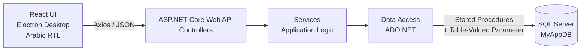
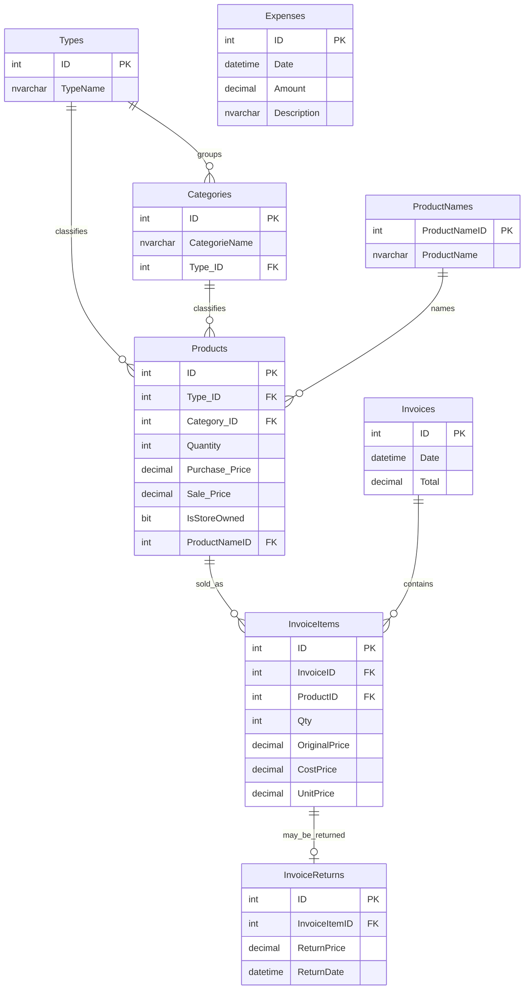

# StoreFlow

**A full-stack accounting and inventory management system for retail businesses, covering invoicing, returns, inventory, expenses, and profit reporting.**

StoreFlow is a desktop accounting application built with **React + Electron**, **ASP.NET Core Web API**, and **Microsoft SQL Server**.

The system is designed around database-driven business rules. Critical operations such as stock validation, invoice creation, returns, referential protection, and financial calculations are enforced inside SQL Server rather than relying solely on the client application.

The application provides an **Arabic RTL interface** designed for desktop retail workflows.

### Project Demo

[Watch the StoreFlow demo on LinkedIn](https://www.linkedin.com/posts/baraa-mardini-a42698356_dotnet-aspnetcore-sqlserver-ugcPost-7487499445195141123-M0k5)

---

## Architecture



The application follows a layered architecture:

| Layer                | Responsibility                                                               |
| -------------------- | ---------------------------------------------------------------------------- |
| **React + Electron** | Desktop UI, user interaction, client-side validation and navigation          |
| **Controller**       | HTTP routing, model binding and HTTP response mapping                        |
| **Service**          | Application-level validation and result shaping                              |
| **Data Access**      | ADO.NET database communication and stored procedure execution                |
| **SQL Server**       | Business rules, transactions, stock operations, data integrity and reporting |

---

## Key Numbers

The following figures are based on the current database schema:

| Metric                   | Count |
| ------------------------ | ----: |
| Tables                   |     8 |
| Stored Procedures        |    35 |
| Scalar Functions         |     9 |
| User-Defined Table Types |     1 |
| Foreign Keys             |     7 |
| Non-Clustered Indexes    |     6 |
| Default Constraints      |     6 |
| Dashboard Sections       |    10 |

### Stored Procedures by Operation

| Operation | Count |
| --------- | ----: |
| Add       |     7 |
| Delete    |     5 |
| Get All   |     9 |
| Get By ID |     6 |
| Search    |     3 |
| Update    |     5 |

---

## Engineering Highlights

### Transaction-Safe Invoice Creation

`SP_AddInvoices` processes the complete invoice inside a single SQL Server transaction.

The operation:

1. Validates the invoice items.
2. Verifies that every product exists.
3. Validates requested quantities against available stock.
4. Creates the invoice header.
5. Inserts invoice lines.
6. Stores historical pricing information.
7. Decrements inventory.
8. Calculates the invoice total.
9. Rolls back the complete transaction if an error occurs.

This prevents partially completed sales from leaving the database in an inconsistent state.

### Table-Valued Parameters

Multiple invoice lines are submitted to SQL Server in a single database call using the `InfoInvoiceItem` table type.

The ADO.NET layer sends the collection as a structured `SqlParameter`:

```csharp
SqlDbType.Structured
```

This allows the entire invoice basket to be processed without executing one database request per line.

### Historical Financial Data

Invoice lines store:

* `OriginalPrice`
* `CostPrice`
* `UnitPrice`

This preserves the financial state of the transaction at the time of sale.

Changing a product's price later does not modify historical invoices or previous profit calculations.

### Per-Line Custom Pricing

The cashier can override the price of an individual invoice item.

The system preserves the original product price in `OriginalPrice` while storing the actual charged price in `UnitPrice`.

### Inventory-Aware Returns

Returns are processed at the invoice-line level.

A return:

* Records the refund value.
* Restores the returned quantity to inventory.
* Prevents the same invoice line from being returned twice.
* Excludes returned lines from sales, cost, profit and units-sold calculations.

### Database-Enforced Business Rules

Important rules are enforced inside SQL Server, including:

* Stock availability.
* Positive quantities.
* Referential integrity.
* Duplicate prevention.
* Category/type consistency.
* Product dependency checks.
* Transaction rollback.
* Financial calculations.

The UI performs early validation for better user experience, while the database remains the authoritative validation layer.

### Structured Error Propagation

Database operations use a consistent error contract:

```text
@Message
@ErrorType
```

The database error code is mapped to a typed application enum and then to an HTTP status code.

This creates a consistent flow:

```text
SQL Server
    ↓
ADO.NET
    ↓
Service
    ↓
Controller
    ↓
HTTP Response
    ↓
React Toast
```

### Async Data Access

The API uses asynchronous database operations throughout the controller, service and data-access layers.

Database resources are disposed asynchronously using `await using`, and requests support `CancellationToken`.

---

# Backend

## ASP.NET Core Web API

The backend exposes REST endpoints while keeping database access isolated inside the data-access layer.

### Response Envelope

API responses follow a consistent structure:

```json
{
  "data": {},
  "message": "Human-readable result",
  "errorCode": 0
}
```

### Error Mapping

| Database Code | Application Error   |                 HTTP Status |
| ------------: | ------------------- | --------------------------: |
|           `0` | `None`              |    `200 OK` / `201 Created` |
|           `1` | `InvalidId`         |           `400 Bad Request` |
|           `2` | `NotFound`          |             `404 Not Found` |
|           `3` | `AlreadyExists`     |              `409 Conflict` |
|           `4` | `LogicalDependency` |              `409 Conflict` |
|          `5+` | `DatabaseError`     | `500 Internal Server Error` |

### Main API Endpoints

| Method | Endpoint                                       | Purpose                              |
| ------ | ---------------------------------------------- | ------------------------------------ |
| `GET`  | `/api/invoicess/GetAllInvoicesByDate`          | Retrieve invoices by date range      |
| `GET`  | `/api/invoicess/{id}`                          | Retrieve an invoice                  |
| `POST` | `/api/invoicess`                               | Create an invoice                    |
| `GET`  | `/api/salesinventorys/SearchSalesInventory`    | Retrieve sales and inventory metrics |
| `GET`  | `/api/InvoiceItemss/GetInvoiceItemByInvoiceID` | Retrieve invoice lines               |
| `GET`  | `/api/InvoiceItemss/SearchInvoiceItems`        | Search invoice lines                 |
| `POST` | `/api/invoicereturnss`                         | Create an invoice return             |
| `GET`  | `/api/invoicereturnss/all`                     | Retrieve invoice returns             |

---

## Data Access

The backend uses plain **ADO.NET** with `Microsoft.Data.SqlClient`.

The data layer handles:

* `SqlConnection`
* `SqlCommand`
* Stored procedure execution
* Typed `SqlParameter`s
* Output parameters
* `DBNull` handling
* `SqlDataReader`
* Table-valued parameters
* Asynchronous database operations
* `CancellationToken`

Stored procedures are used as the database access contract rather than dynamically constructed SQL queries.

---

# Frontend

## React + Electron

The frontend is packaged as a desktop application using Electron.

### Main Technologies

* React
* React Router
* Axios
* React Select
* Lucide React
* Electron
* CSS variables and utility classes

### UI Features

* Arabic interface
* RTL layout
* Collapsible sidebar
* Dashboard
* Searchable dropdowns
* Toast notifications
* Pagination
* Filtering
* Invoice management
* Product management
* Inventory monitoring
* Sales reporting

### Application Sections

| Section       | Features                                          |
| ------------- | ------------------------------------------------- |
| **Dashboard** | Sales, inventory and financial overview           |
| **Catalogue** | Types, categories, product names and products     |
| **Finance**   | Expense management                                |
| **Sales**     | Create invoices, view invoices, sales and returns |
| **Reports**   | Sales, profit, expenses and inventory metrics     |

---

# Invoice Workflow

The invoice creation screen provides a complete sales workflow:

1. Loads products into a paginated table.
2. Supports filtering by product name, type and category.
3. Allows a custom price for each selected product.
4. Allows the cashier to specify quantities.
5. Calculates totals in real time.
6. Validates quantities against available stock.
7. Prevents invalid invoice submission.
8. Sends the complete basket to the API.
9. Processes the invoice atomically inside SQL Server.
10. Refreshes inventory after a successful transaction.

Example request:

```http
POST /api/invoicess
Content-Type: application/json
```

```json
[
  {
    "productID": 1,
    "qty": 2,
    "price": 15
  },
  {
    "productID": 3,
    "qty": 1,
    "price": 42
  }
]
```

Example successful response:

```json
{
  "data": {
    "id": 120,
    "date": "2026-07-24T19:49:44",
    "total": 72
  },
  "message": "تم إنشاء الفاتورة بنجاح",
  "errorCode": 0
}
```

---

# Data Model



---

# Database Design

The database contains eight main tables:

* `Types`
* `Categories`
* `ProductNames`
* `Products`
* `Invoices`
* `InvoiceItems`
* `InvoiceReturns`
* `Expenses`

### Integrity and Indexing

The database includes:

* 7 foreign keys
* 6 non-clustered indexes
* 6 default constraints
* Referential integrity rules
* Unique constraints for catalogue entities
* Dependency checks before deletion
* Transaction-based inventory updates

### Product Hierarchy

Products are connected to:

```text
Type
  └── Category
        └── Product
              └── Product Name
```

When a category is assigned to a product, the product's `Type_ID` is derived from the category's type during insert/update operations.

This prevents inconsistent Type/Category relationships.

---

# Business Rules

## Invoice Rules

`SP_AddInvoices` validates the complete invoice before committing changes.

| Code | Rule                                             |
| ---: | ------------------------------------------------ |
|  `1` | Invoice must contain at least one item           |
|  `2` | Every quantity must be greater than zero         |
|  `3` | Every product must exist                         |
|  `4` | Requested quantity cannot exceed available stock |
|  `5` | Unexpected database error                        |

On successful execution, the procedure:

* Creates the invoice.
* Inserts invoice items.
* Snapshots the original product price.
* Stores purchase cost.
* Stores the actual sale price.
* Decrements inventory.
* Calculates the invoice total.
* Returns the created invoice information.

---

## Return Rules

Returns are handled per invoice line.

The system:

* Allows one return per invoice line.
* Restores returned stock.
* Stores the total refund amount.
* Excludes returned lines from sales calculations.
* Excludes returned lines from profit calculations.
* Excludes returned lines from units-sold calculations.

---

## Catalogue Rules

The database protects catalogue consistency through rules such as:

* Type names must be unique.
* Category names are unique within their type.
* Product names are trimmed before comparison/storage.
* Product quantity cannot be negative.
* Products cannot be deleted when referenced by invoice items.
* Types, categories and product names cannot be deleted when dependent records exist.
* Product Type is derived from its Category when applicable.

---

# Ownership Segmentation

Products contain an `IsStoreOwned` flag that separates inventory into two ownership groups.

The reporting and invoice-item search operations support:

|  Value | Meaning                  |
| -----: | ------------------------ |
|    `1` | Store-owned products     |
|    `0` | Non-store-owned products |
| `NULL` | Both groups              |

This allows reports to distinguish between store-owned and externally owned inventory.

---

# Reporting Engine

The reporting system is centered around:

```text
SP_SearchSalesInventory
```

The procedure returns nine financial and inventory metrics.

| Metric                      | Calculation                                  |
| --------------------------- | -------------------------------------------- |
| `TotalCost`                 | Cost of non-returned sold items              |
| `TotalProfit`               | Sale price minus cost for non-returned items |
| `TotalInventorySaleValue`   | Sale value of non-returned sold items        |
| `TotalProductsSold`         | Quantity sold excluding returned lines       |
| `TotalReturnCost`           | Value of returned items                      |
| `TotalExpenses`             | Total recorded expenses                      |
| `TotalProducts`             | Current quantity in inventory                |
| `TotalPurchasePriceProduct` | Current inventory valued at purchase price   |
| `TotalSalePriceProduct`     | Current inventory valued at sale price       |

The calculations are implemented through nine reusable scalar functions.

### Supported Periods

| Period | Description       |
| -----: | ----------------- |
|    `1` | Today             |
|    `2` | Current week      |
|    `3` | Current month     |
|    `4` | Last 30 days      |
|    `5` | Current year      |
|    `6` | Custom date range |
| `NULL` | All time          |

Current inventory valuation is independent of the selected sales period because it represents the current state of inventory.

---

# Stored Procedure Catalogue

### Types

```text
SP_AddTypes
SP_GetAllTypes
SP_GetTypesByID
SP_UpdateTypesByID
SP_DeleteTypesByID
```

### Categories

```text
SP_AddCategories
SP_GetAllCategories
SP_GetCategoriesByID
SP_UpdateCategoriesByID
SP_DeleteCategoriesByID
```

### Product Names

```text
SP_AddProductNames
SP_GetAllProductNames
SP_GetProductNamesByProductNameID
SP_UpdateProductNamesByProductNameID
SP_DeleteProductNamesByProductNameID
```

### Products

```text
SP_AddProducts
SP_GetProductsByID
SP_UpdateProductsByID
SP_DeleteProductsByID
SP_SearchProducts
SP_GetAllNumberProducts
```

### Invoices

```text
SP_AddInvoices
SP_GetInvoicesByID
SP_GetAllInvoicesByDate
SP_GetAllInvoiceItemsByInvoiceID
SP_GetAllInvoiceItems
SP_SearchInvoiceItems
```

### Returns

```text
SP_AddInvoiceReturns
SP_GetAllInvoiceReturns
```

### Expenses

```text
SP_AddExpenses
SP_GetAllExpenses
SP_GetExpensesByID
SP_UpdateExpensesByID
SP_DeleteExpensesByID
```

### Reporting

```text
SP_SearchSalesInventory
```

---

# Search Capabilities

### Product Search

`SP_SearchProducts` supports prefix-based searching across:

* Product name
* Type name
* Category name

It can also order products by ascending quantity for low-stock monitoring.

### Invoice Item Search

Invoice item operations support filtering by:

* Product
* Type
* Category
* Ownership
* Date range
* Invoice ID

Returned invoice lines can also be identified through the `IsReturned` flag.

---

# Error Contract

All database operations use a consistent output-parameter contract:

```sql
@Message NVARCHAR OUTPUT,
@ErrorType INT OUTPUT
```

Add procedures additionally return:

```sql
@NewID INT OUTPUT
```

### Error Codes

| Code | Meaning                                                           |
| ---: | ----------------------------------------------------------------- |
|  `0` | Success                                                           |
|  `1` | Invalid ID or validation failure                                  |
|  `2` | Record not found                                                  |
|  `3` | Duplicate / already exists                                        |
|  `4` | Logical dependency, related-record conflict or insufficient stock |
|  `5` | Unexpected database error                                         |

This contract allows the same business result to propagate consistently from SQL Server to the API and finally to the desktop UI.

---

# Usage Examples

## Create an Invoice in SQL Server

```sql
DECLARE @Items dbo.InfoInvoiceItem;

INSERT INTO @Items (ProductId, Quantity, Price)
VALUES
    (1, 2, 15.00),
    (3, 1, 42.50);

DECLARE @NewID INT,
        @Message NVARCHAR(250),
        @ErrorType INT;

EXEC dbo.SP_AddInvoices
     @Items     = @Items,
     @NewID     = @NewID OUTPUT,
     @Message   = @Message OUTPUT,
     @ErrorType = @ErrorType OUTPUT;

SELECT
    @NewID AS InvoiceID,
    @Message AS Message,
    @ErrorType AS ErrorType;
```

## Create a Return

```sql
DECLARE @NewID INT,
        @Message NVARCHAR(250),
        @ErrorType INT;

EXEC dbo.SP_AddInvoiceReturns
     @InvoiceItemID = 10,
     @NewID         = @NewID OUTPUT,
     @Message       = @Message OUTPUT,
     @ErrorType     = @ErrorType OUTPUT;
```

## Monthly Store-Owned Report

```http
GET /api/salesinventorys/SearchSalesInventory?Period=3&IsStoreOwned=true
```

## Custom Report Range

```sql
EXEC dbo.SP_SearchSalesInventory
     @Period   = 6,
     @FromDate = '2026-01-01',
     @ToDate   = '2026-03-31';
```

## Low-Stock Products

```sql
EXEC dbo.SP_SearchProducts
     @OrderByLowestQuantity = 1;
```

---

# Getting Started

## Requirements

* SQL Server 2019 or later
* .NET SDK
* Node.js
* SSMS, Azure Data Studio, or `sqlcmd`

The database uses SQL Server compatibility level `150`.

---

## 1. Create the Database

Create the database:

```sql
CREATE DATABASE [MyAppDB];
```

Then execute the database schema script:

```bash
sqlcmd -S localhost -i MyAppDB.sql
```

The script creates:

* Tables
* Foreign keys
* Indexes
* Constraints
* User-defined table type
* Scalar functions
* Stored procedures

---

## 2. Verify the Database

```sql
USE MyAppDB;

SELECT COUNT(*) AS StoredProcedures
FROM sys.procedures;

SELECT COUNT(*) AS Tables
FROM sys.tables;
```

Expected result:

```text
Stored Procedures: 35
Tables: 8
```

---

## 3. Configure the Backend

Configure the application's SQL Server connection string for your environment.

Then run:

```bash
dotnet restore
dotnet run
```

---

## 4. Configure the Frontend

Install dependencies:

```bash
npm install
```

Configure the API base URL in the shared Axios instance.

Then start the Electron application using the project's configured development command.

---

# Project Structure

A simplified project structure:

```text
StoreFlow/
│
├── backend/
│   ├── Controllers/
│   ├── Services/
│   ├── Data/
│   ├── Models/
│   └── Program.cs
│
├── frontend/
│   ├── src/
│   │   ├── components/
│   │   ├── pages/
│   │   ├── services/
│   │   ├── contexts/
│   │   └── ...
│   ├── electron/
│   └── package.json
│
├── database/
│   └── MyAppDB.sql
│
└── README.md
```

---

# Tech Stack

| Layer                      | Technologies                                           |
| -------------------------- | ------------------------------------------------------ |
| **Desktop**                | Electron                                               |
| **Frontend**               | React, React Router, Axios, React Select, Lucide React |
| **Backend**                | ASP.NET Core Web API, C#                               |
| **Data Access**            | ADO.NET, Microsoft.Data.SqlClient                      |
| **Database**               | Microsoft SQL Server, T-SQL                            |
| **Database Communication** | Stored Procedures, Table-Valued Parameters             |
| **Architecture**           | Layered Architecture                                   |
| **Async Processing**       | async/await, CancellationToken                         |

---

# Project Focus

StoreFlow was built to demonstrate a complete database-driven business application rather than a collection of basic CRUD screens.

The main engineering focus is on:

* Transaction-safe inventory operations
* ASP.NET Core Web API architecture
* ADO.NET database integration
* Stored-procedure-driven data access
* Table-valued parameters
* Database-enforced business rules
* Historical financial data
* Inventory and return reconciliation
* Structured error propagation
* Financial and inventory reporting
* Layered backend architecture
* React + Electron desktop development
* Arabic RTL user interface

The result is a complete retail management system connecting a **React/Electron desktop client**, an **ASP.NET Core Web API**, and a **transactional SQL Server database**.
